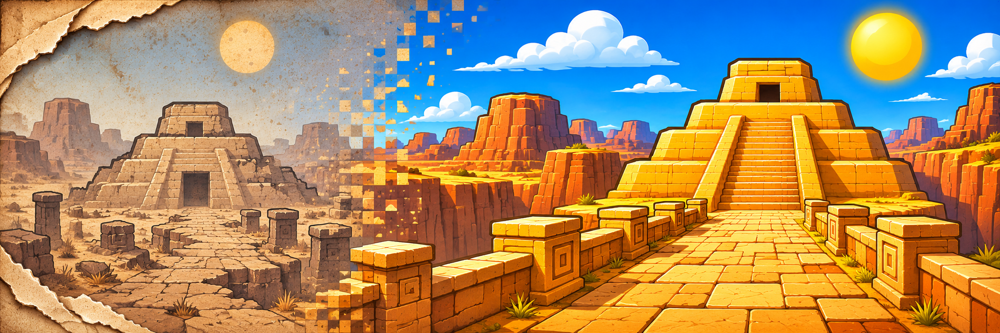

# Good Trip Good Tip

**Giving old games a second life.**

Mods for classic games, made by a pro game dev. I also share the occasional small tool from a side project.

## In the works

### NeonLoop

**NeonLoop** is a Windows mod in development for *2064: Read Only Memories*.

- Resize the game window to fit your setup.
- Adjust the visual effects to suit your screen.
- Choose from optional soundtracks for another playthrough.

---

[Browse my repositories](https://github.com/goodtripgoodtip?tab=repositories)

I build and test these projects with [OpenAI Codex](https://github.com/openai/codex) as my AI co-developer. Projects I release here credit Codex in their README. [OpenAI on GitHub](https://github.com/openai)
